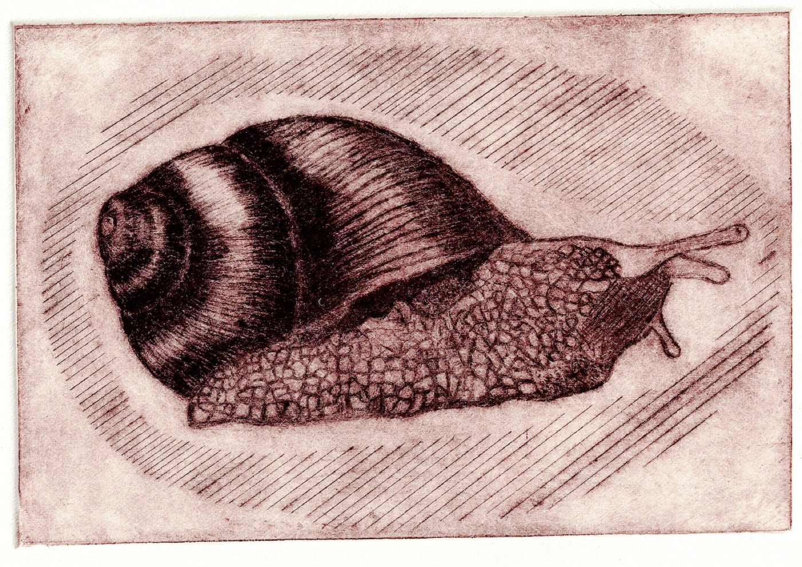
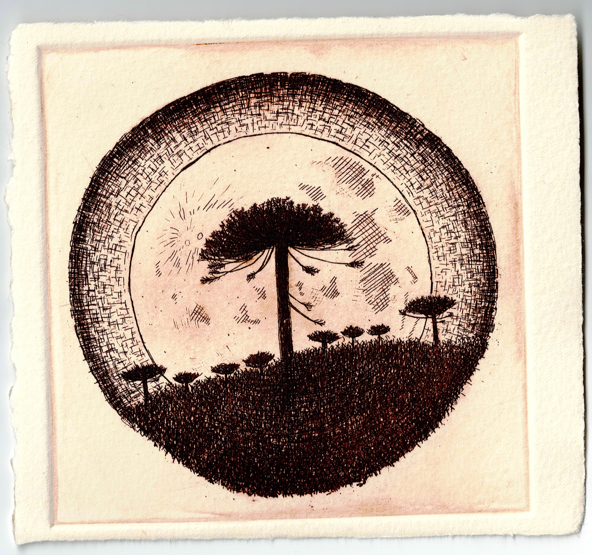
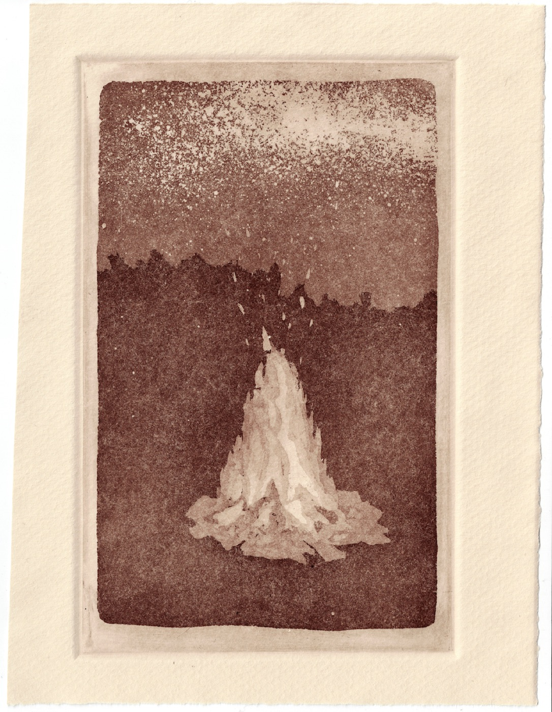
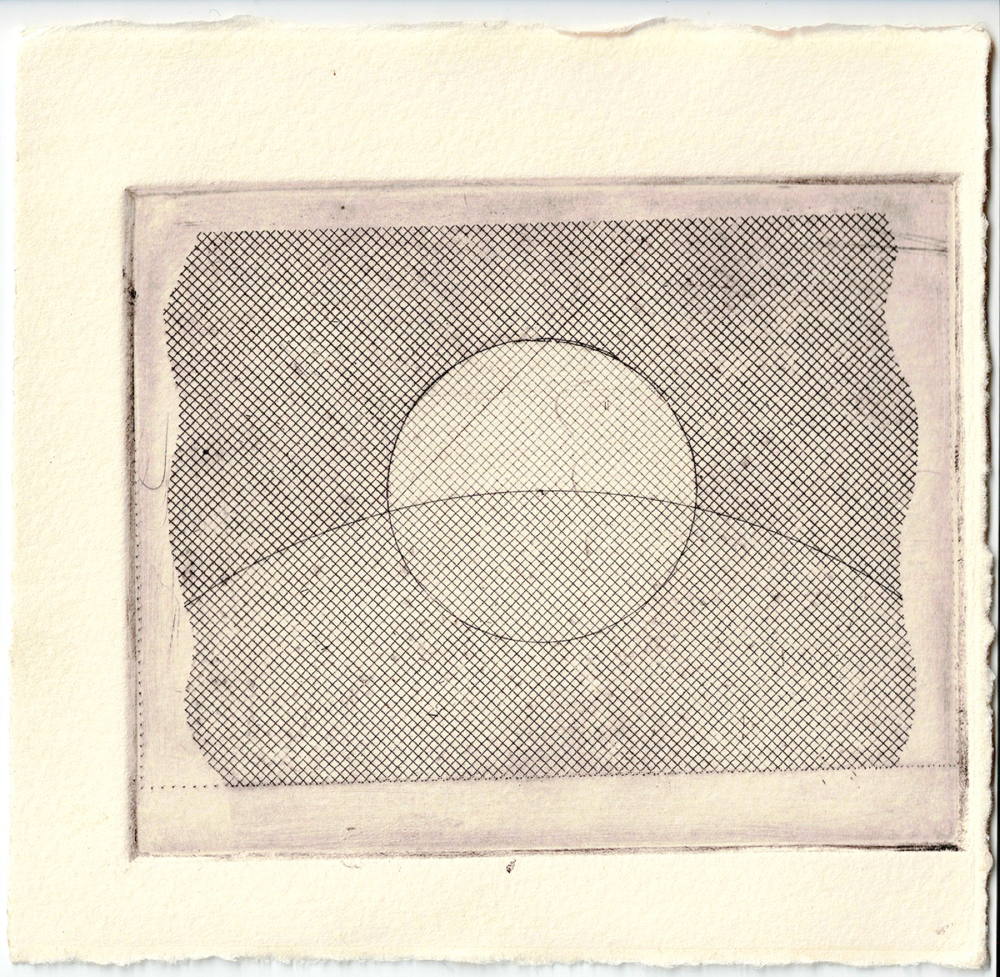

:::: {.content-visible when-profile="esp"}
Durante el 2025 participé del taller de calcografía del Museo Universitario del Grabado, dirigido por el maestro grabador Ismael Díaz. Estas son las obras que creé. Haz clic en cualquiera para verla en grande.

::: {.art-gallery}
{group="obras"}

{group="obras"}

{group="obras"}

{group="obras"}
:::
::::

:::: {.content-visible when-profile="eng"}
During 2025 I took part in the engraving workshop at the Museo Universitario del Grabado, led by master engraver Ismael Díaz. These are the works I created. Click any of them to enlarge.

::: {.art-gallery}
{group="works"}

{group="works"}

{group="works"}

{group="works"}
:::
::::
